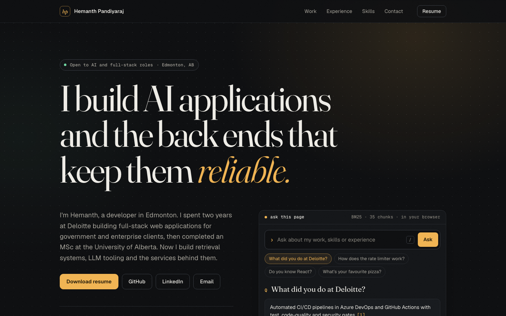

# Hemanth Pandiyaraj · Portfolio

My personal site: who I am, what I have built, and the tests that prove it works.



## Highlights

- **Ask this page.** The hero is a question box that searches the site's own content with BM25 and answers with numbered, linked sources. When nothing on the page covers the question it says so. It runs in the browser: no server, no API key, no LLM.
- **A live demo for each project.** A port of the gateway's token-bucket limiter you can fire 200 requests at, and a market panel that reads Coinbase's public trade feed and recomputes rolling metrics every second, with reconnect and backoff.
- **Typed content layer.** Every project, role and skill is data in [`lib/content.ts`](lib/content.ts), checked by TypeScript in strict mode. The search index is built from the same file, so the two cannot drift apart.
- **Typography-led dark design.** A serif display face, one accent colour and hairline rules.
- **Accessible by default.** Semantic landmarks, a skip link, visible focus states, AA contrast, keyboard-operable demos and support for `prefers-reduced-motion`.
- **Zero UI dependencies.** Next.js, React and TypeScript only. No component kit, no CSS framework, no animation library.

## Tech stack

| Layer | Choice |
|-------|--------|
| Framework | Next.js (App Router), statically prerendered |
| Language | TypeScript, strict mode |
| Styling | Plain CSS with custom properties |
| Motion | CSS animations and scroll-driven animations |
| Search | BM25, written from scratch in `lib/search.ts` |
| Live data | Coinbase public WebSocket feed, read directly by the browser |
| Hosting | Vercel |

## Project structure

```
app/
  layout.tsx            Fonts, metadata and the HTML shell
  page.tsx              Page composition
  globals.css           Design tokens and all styles
  opengraph-image.tsx   The card shown when the link is shared
components/
  AskConsole.tsx        Hero question box (client component)
  AskPointer.tsx        How the question box compares to the RAG project
  TokenBucketDemo.tsx   Rate limiter demo (client component)
  LiveFeedDemo.tsx      Live market data demo (client component)
  ProjectCard.tsx       Project case-study row with its demo
  Nav.tsx               Sticky navigation with the current section marked
  CopyEmail.tsx         Copy-to-clipboard button
lib/
  content.ts            Typed site content
  search.ts             BM25 index and search over that content
public/               Static assets, including the resume PDF
```

## Getting started

Requires Node.js 20 or later.

```bash
npm install
npm run dev        # http://localhost:3000
```

| Command | What it does |
|---------|--------------|
| `npm run dev` | Start the development server |
| `npm run build` | Create a production build |
| `npm run start` | Serve the production build |
| `npm run typecheck` | Check types without emitting files |

## Editing content

All copy lives in `lib/content.ts`. To add a project, append an object to the `projects` array. The `Project` type tells you which fields are required. The question box picks up new content automatically.

## Design tokens

Defined at the top of `app/globals.css`.

| Token | Purpose |
|-------|---------|
| `--bg`, `--ink`, `--muted`, `--faint` | Page background, text, secondary and tertiary text |
| `--surface`, `--raised` | Demo panels and the controls inside them |
| `--line` | Hairline rules between rows and sections |
| `--accent` | The single accent colour, used for links, proof numbers and primary actions |
| `--ok`, `--bad` | Allowed and rejected requests, price up and down |
| `--display`, `--sans`, `--mono` | Display, body and label typefaces (Fraunces, Geist, Geist Mono) |
| `--section` | Vertical rhythm between sections |

## Deployment

The site deploys to Vercel on every push to `main`. No environment variables are needed.

## Licence

The code is available under the MIT licence. The written content and resume are my own and are not licensed for reuse.
